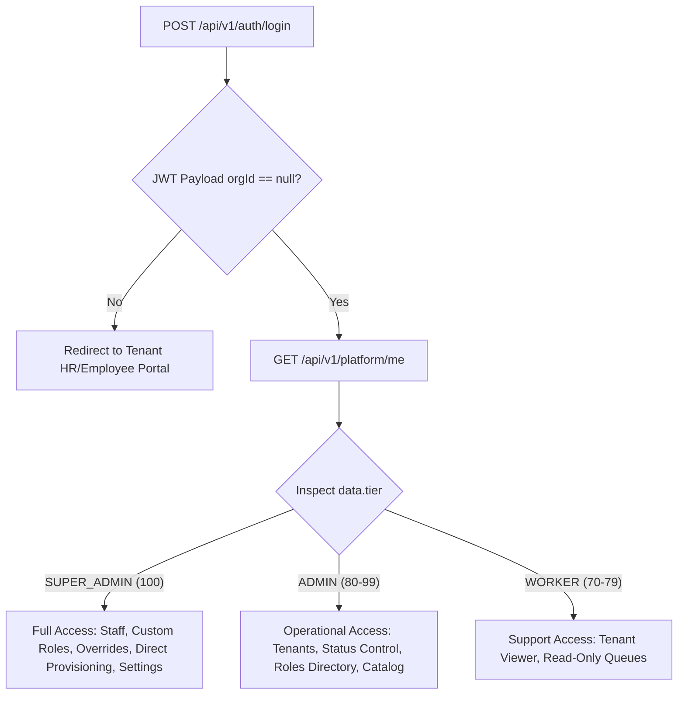

# Platform Super Admin Panel — Frontend API Integration & UI Architecture Guide

> **Target Audience:** Frontend Engineers, UI/UX Designers, Product Architects  
> **Backend Module:** Platform Admin (`src/modules/platform/`)  
> **Base URL:** `/api/v1/platform`  
> **Status:** Authoritative Specification — Covers **Implemented APIs (#281–#295)** & **Planned Backend Roadmap (#296–#335)**  
> **Document Location:** `public/md_platform-admin/frontend_api_integration_guide.md`  

---

## Table of Contents

1. [Executive Overview & UI Architecture](#1-executive-overview--ui-architecture)
2. [Dual-Plane Architecture & Authentication Model](#2-dual-plane-architecture--authentication-model)
3. [The 3-Tier RBAC & Navigation Model](#3-the-3-tier-rbac--navigation-model)
4. [Global Error Codes & Client Handling Contract](#4-global-error-codes--client-handling-contract)
5. [Frontend Design Invariants & UX Guidelines](#5-frontend-design-invariants--ux-guidelines)
6. [Part 1: Currently Implemented APIs & Screens (Phases 1–4)](#6-part-1-currently-implemented-apis--screens-phases-14)
   - [6.1 Platform Shell & Identity Bootstrap (#281)](#61-platform-shell--identity-bootstrap-281)
   - [6.2 Staff Directory & Team Management (#282–#285)](#62-staff-directory--team-management-282285)
   - [6.3 Platform Role Catalog & Custom Roles (#286–#287)](#63-platform-role-catalog--custom-roles-286287)
   - [6.4 Public Staff Activation Flow (#288)](#64-public-staff-activation-flow-288)
   - [6.5 Tenant Organization Directory (#289)](#65-tenant-organization-directory-289)
   - [6.6 Organization Diagnostic Detail Card (#290)](#66-organization-diagnostic-detail-card-290)
   - [6.7 Tenant Status Control / Kill Switch (#291)](#67-tenant-status-control--kill-switch-291)
   - [6.8 Complimentary Plan Override Drawer (#292)](#68-complimentary-plan-override-drawer-292)
   - [6.9 Live Seat Quota Adjustment Modal (#293)](#69-live-seat-quota-adjustment-modal-293)
   - [6.10 Direct Tenant Provisioning Wizard (#294)](#610-direct-tenant-provisioning-wizard-294)
   - [6.11 HR Invitation Recovery (#295)](#611-hr-invitation-recovery-295)
7. [Part 2: Upcoming Backend Capabilities & Wireframing Roadmap (Phases 5–11)](#7-part-2-upcoming-backend-capabilities--wireframing-roadmap-phases-511)
   - [7.1 Phase 5: Plan Catalog & Entitlements Matrix (#296–#299)](#71-phase-5-plan-catalog--entitlements-matrix-296299)
   - [7.2 Phase 6: Dual-Plane Support Desk (#300–#307)](#72-phase-6-dual-plane-support-desk-300307)
   - [7.3 Phase 7: Forensics, Audit Log Browser & Dashboard (#308–#311)](#73-phase-7-forensics-audit-log-browser--dashboard-308311)
   - [7.4 Phase 8: Data Exports & Billing Reconciliation Desk (#312–#317)](#74-phase-8-data-exports--billing-reconciliation-desk-312317)
   - [7.5 Phase 9: Marketing Hub & Promotional Campaigns (#318–#329)](#75-phase-9-marketing-hub--promotional-campaigns-318329)
   - [7.6 Phase 10: Global Platform Announcement Banners (#330–#333)](#76-phase-10-global-platform-announcement-banners-330333)
   - [7.7 Phase 11: Read-Only Support Diagnostic Sessions (#334–#335)](#77-phase-11-read-only-support-diagnostic-sessions-334335)
8. [Complete Frontend Navigation Sitemap & Route Guard Matrix](#8-complete-frontend-navigation-sitemap--route-guard-matrix)

---

## 1. Executive Overview & UI Architecture

The **Platform Super Admin Panel** is the centralized mission-control console for HR Clouds operators to manage platform staff, tenant organizations, commercial subscriptions, quotas, and platform diagnostics.



### Key Highlights for Frontend Teams
- **Zero Local Client Role Derivation:** The client never hardcodes or matches string names like `"super-admin"` or `"billing-operator"`. Authorization is driven entirely by the integer priority mapped to the **`tier`** field returned by `GET /api/v1/platform/me`.
- **Instant Revocation & Fail-Closed Guards:** Every single platform API request triggers a real-time database verification. If an administrator is demoted or revoked, their next API call fails with `403 PLATFORM_ACCESS_REVOKED`, and the frontend must immediately terminate the session.
- **Lightweight Summaries vs. Deep Detail Cards:** Multi-row list endpoints return lightweight summary cards for table grids. Deep diagnostic views and historical logs are isolated to single-entity detail routes.

---

## 2. Dual-Plane Architecture & Authentication Model

The backend separates all traffic into two completely isolated planes:

| Plane | Description | Token Characteristic | Valid Endpoints |
|---|---|---|---|
| **Platform Plane** | Platform Super Admins, Operations, Support staff | `orgId === null`<br>`role = 'super-admin'`, `'admin'`, `'worker'`, or custom slug | `/api/v1/platform/*` |
| **Tenant Plane** | Client HRs, Managers, Employees | `orgId === '<UUID>'`<br>`role = 'hr'`, `'manager'`, `'employee'` | All standard tenant modules (Payroll, Leave, Attendance) |

### Handling Cross-Plane Boundary Violations
1. If a regular tenant user accidentally navigates to the Platform Admin URL, the platform backend returns `403 PLATFORM_ACCESS_REQUIRED`. The frontend router must redirect them back to the client dashboard (`/dashboard`).
2. Platform staff tokens carry `orgId: null`. If a platform token is sent to a tenant-specific API, the backend rejects it with `400 MISSING_ORG_CONTEXT`.

---

## 3. The 3-Tier RBAC & Navigation Model

Instead of a complex permission checklist or ABAC engine, the platform uses a 3-tier hierarchy derived strictly from role **`priority`** ($70 \le \text{priority} \le 100$):

```
┌────────────────────────────────────────────────────────────────────────┐
│  SUPER_ADMIN (Priority = 100)                                          │
│  • Full control: Staff invitations, role changes, revocations         │
│  • Custom platform role creation (71–99)                               │
│  • Plan overrides (free licenses, validity dates, feature toggles)     │
│  • Seat quota adjustments & Direct tenant provisioning                 │
│  • Forensics, financial exports, campaign launch                      │
├────────────────────────────────────────────────────────────────────────┤
│  ADMIN (Priority = 80–99)                                              │
│  • Operational tenant management: Search, filter, view details         │
│  • Tenant status kill-switch: Suspend / Reactivate organizations       │
│  • View platform role catalog & staff holder counts                    │
│  • Support ticket assignment, template library inspection             │
├────────────────────────────────────────────────────────────────────────┤
│  WORKER (Priority = 70–79)                                             │
│  • Support operations: Read-only tenant diagnostics                   │
│  • Support desk queue triage & client reply                            │
│  • Self profile & platform bootstrap                                   │
└────────────────────────────────────────────────────────────────────────┘
```

### UI Navigation Guard Implementation Rule
On initial load, store the `tier` returned from `GET /api/v1/platform/me` in global app state (e.g., Redux / Zustand / React Context):
```typescript
interface PlatformActor {
  id: string;
  identifier: string;
  first_name: string | null;
  last_name: string | null;
  role: {
    key: string;
    name: string;
    priority: number;
  };
  tier: 'SUPER_ADMIN' | 'ADMIN' | 'WORKER';
}

// Client-side route guard helper
export const canAccessTier = (userTier: string, requiredTier: string): boolean => {
  const ranks: Record<string, number> = { WORKER: 1, ADMIN: 2, SUPER_ADMIN: 3 };
  return (ranks[userTier] || 0) >= (ranks[requiredTier] || 0);
};
```

---

## 4. Global Error Codes & Client Handling Contract

The backend uses structured error envelopes. Every error response follows this schema:
```json
{
  "success": false,
  "error": {
    "code": "STRING_ERROR_CODE",
    "message": "Human readable explanation"
  }
}
```

### Error Code Handling Matrix for Frontend

| HTTP Status | Error Code | Meaning | Required Frontend Action |
|:---:|---|---|---|
| **401** | `TOKEN_EXPIRED`<br>`TOKEN_INVALID` | Session expired or signature invalid. | Clear stored JWT and redirect to `/login`. |
| **403** | `PLATFORM_ACCESS_REVOKED` | User was staff, but their account was soft-deleted, deactivated, or demoted in the database. | **Force logout immediately**, flush local storage, and show notification: *"Your administrative access has been revoked."* |
| **403** | `PLATFORM_ACCESS_REQUIRED` | Caller holds a valid tenant token, but has no platform plane privileges. | Block access. Redirect to `/app/dashboard`. |
| **403** | `FORBIDDEN` | Valid staff member, but role priority is below the required tier. | Keep session active; display a 403 Forbidden banner or disable the restricted UI action. |
| **409** | `STAFF_CHANGE_IN_PROGRESS` | Advisory lock contention (`platform:super_admin_set`) between concurrent admin operations. | Show toast: *"Staff update is processing, please wait..."* and retry automatically after 1.5 seconds. |
| **409** | `STALE_SUBSCRIPTION` | Concurrency conflict: another operator modified the subscription while this drawer was open (`expected_subscription_id` mismatch). | Refresh organization details and alert: *"Subscription was updated by another administrator. Details have been refreshed."* |
| **409** | `PAYMENT_IN_PROGRESS` | Tenant is currently in an active Razorpay checkout session. Plan override cannot be granted. | Show modal warning: *"Tenant has an active checkout in progress. Please wait for checkout completion or cancellation before overriding."* |
| **409** | `ORG_HAS_ACTIVE_HR` | Cannot send initial provisioning HR invite because an active HR administrator already exists. | Disable re-invitation button. Direct operator to standard tenant member management. |
| **400** | `INVALID_INVITATION` | On `/auth/accept-invite`: Token is invalid, expired, or already used. | Display generic alert: *"This invitation is no longer valid. Please contact your system administrator to re-issue it."* |

---

## 5. Frontend Design Invariants & UX Guidelines

1. **Dual Usability Indicators on Staff Cards (#282):**
   - Every staff row returns two booleans: `is_active` (account active) and `invitation_pending` (has not yet set password).
   - Render a dual badge system:
     - `invitation_pending === true` $\rightarrow$ Amber badge: `Pending Activation`
     - `is_active === true && !invitation_pending` $\rightarrow$ Green badge: `Active`
     - `is_active === false` $\rightarrow$ Red badge: `Deactivated / Revoked`
2. **Resilient Multi-Panel Degradation (#290):**
   - The organization diagnostic detail screen renders 6 independent diagnostic panels (`subscription`, `usage`, `setup`, `recent_subscription_events`, `recent_audit_logs`, `limits_audit`).
   - If any sub-system has a query glitch, that panel returns `null` and its key is appended to `unavailable: ["setup", ...]`.
   - **Never crash the screen.** Render an inline skeleton or warning card: *"Unable to load setup checklist. Click to retry."*
3. **Factual Integrity on Usage Metrics (#289, #290):**
   - If counting employee memberships fails, the backend returns `null`, **never `0`**.
   - If `active_employees === null`, display `"—"` or `"Data unavailable"`. Never show `"0 / 50 seats"`, as this could mislead an operator into taking drastic actions.
4. **Dangerous Actions Require Double Confirmation:**
   - Suspending an organization (#291), changing a staff role (#284), or revoking staff access (#285) requires a mandatory `reason` string (10–500 characters).
   - Frontend must prompt with a modal dialog containing a required multi-line textarea before submitting.

---

## 6. Part 1: Currently Implemented APIs & Screens (Phases 1–4)

All endpoints below are **fully implemented, tested, and live in the backend**. Frontend developers can build against them immediately.

---

### 6.1 Platform Shell & Identity Bootstrap (#281)

- **Endpoint:** `GET /api/v1/platform/me`
- **Method:** `GET`
- **Access / Role:** Protected · Platform Plane · Minimum Tier: `WORKER` (Priority $\ge 70$)
- **Purpose:** Fetches the logged-in operator's profile, role details, and UI navigation tier.

#### Success Response (`200 OK`)
```json
{
  "success": true,
  "message": "Platform profile fetched successfully",
  "data": {
    "id": "8f2c1d4a-57c6-4a1b-9f3e-6c2b8d4a1e55",
    "identifier": "ops.lead@hrclouds.in",
    "identifier_type": "email",
    "status": "active",
    "last_login_at": "2026-11-18T01:30:00.000Z",
    "role": {
      "key": "super-admin",
      "name": "Super Admin",
      "priority": 100
    },
    "tier": "SUPER_ADMIN",
    "profile": {
      "first_name": "Arun",
      "last_name": "Kumar",
      "display_name": "Arun Kumar",
      "phone_number": "+919876543210",
      "avatar_url": null
    }
  }
}
```

---

### 6.2 Staff Directory & Team Management (#282–#285)

#### API #282 — Staff Directory
- **Endpoint:** `GET /api/v1/platform/admins`
- **Access:** `SUPER_ADMIN` (100)
- **Query Params:** `page` (default: 1), `limit` (default: 25, max: 100).
- **Response:**
```json
{
  "success": true,
  "message": "Platform staff fetched successfully",
  "data": {
    "staff": [
      {
        "id": "8f2c1d4a-57c6-4a1b-9f3e-6c2b8d4a1e55",
        "email": "ops.lead@hrclouds.in",
        "first_name": "Arun",
        "last_name": "Kumar",
        "role": {
          "key": "super-admin",
          "name": "Super Admin",
          "priority": 100,
          "tier": "SUPER_ADMIN"
        },
        "is_active": true,
        "invitation_pending": false,
        "last_login_at": "2026-11-18T01:30:00.000Z",
        "assigned_at": "2026-11-01T10:00:00.000Z"
      }
    ],
    "pagination": {
      "page": 1,
      "limit": 25,
      "total_items": 4,
      "total_pages": 1
    }
  }
}
```

#### API #283 — Invite or Grant Platform Staff Access
- **Endpoint:** `POST /api/v1/platform/admins/invite`
- **Access:** `SUPER_ADMIN` (100)
- **Request Body:**
```json
{
  "email": "priya.sharma@hrclouds.in",
  "first_name": "Priya",
  "last_name": "Sharma",
  "role_key": "admin"
}
```
- **Response (`201 Created` for new invitation):**
```json
{
  "success": true,
  "message": "Platform invitation dispatched successfully",
  "data": {
    "user_id": "b1e2c3d4-e5f6-7a8b-9c0d-1e2f3a4b5c6d",
    "email": "priya.sharma@hrclouds.in",
    "role_key": "admin",
    "activation_required": true,
    "activation_link": "https://admin.hrclouds.in/activate?token=9f8e7d6c5b4a3...",
    "expires_at": "2026-11-20T03:00:00.000Z"
  }
}
```
> [!NOTE]
> The `activation_link` is returned in the response so the super-admin can copy it manually if email dispatch is delayed. Show a *"Copy Invitation Link"* toast or dialog.

#### API #284 — Change Staff Role
- **Endpoint:** `PATCH /api/v1/platform/admins/:userId/role`
- **Access:** `SUPER_ADMIN` (100)
- **Request Body:**
```json
{
  "role_key": "custom-billing-admin",
  "reason": "Promoted to billing lead for Q4 enterprise rollout"
}
```

#### API #285 — Revoke Staff Access
- **Endpoint:** `DELETE /api/v1/platform/admins/:userId`
- **Access:** `SUPER_ADMIN` (100)
- **Request Body:**
```json
{
  "reason": "Contract ended on 2026-11-17"
}
```

---

### 6.3 Platform Role Catalog & Custom Roles (#286–#287)

#### API #286 — Platform Role Catalog
- **Endpoint:** `GET /api/v1/platform/roles`
- **Access:** `ADMIN` (80+)
- **Response:**
```json
{
  "success": true,
  "message": "Platform roles fetched successfully",
  "data": {
    "roles": [
      {
        "id": "1a2b3c4d-5e6f-7a8b-9c0d-1e2f3a4b5c6d",
        "key": "super-admin",
        "name": "Super Admin",
        "description": "Full access to all platform administrative capabilities",
        "priority": 100,
        "tier": "SUPER_ADMIN",
        "is_system_role": true,
        "is_active": true,
        "assignable_via_api": false,
        "active_holders_count": 2
      },
      {
        "id": "2b3c4d5e-6f7a-8b9c-0d1e-2f3a4b5c6d7e",
        "key": "admin",
        "name": "Platform Admin",
        "description": "Tenant visibility and operational status controls",
        "priority": 80,
        "tier": "ADMIN",
        "is_system_role": true,
        "is_active": true,
        "assignable_via_api": true,
        "active_holders_count": 5
      }
    ]
  }
}
```

#### API #287 — Create Custom Platform Role
- **Endpoint:** `POST /api/v1/platform/roles`
- **Access:** `SUPER_ADMIN` (100)
- **Validation:** Priority must be strictly between **71 and 99**. (70 and 100 are reserved system floors).
- **Request Body:**
```json
{
  "key": "support-tier-2",
  "name": "Tier 2 Support Specialist",
  "description": "Extended support with access to diagnostic logs and queue reassignment",
  "priority": 75
}
```

---

### 6.4 Public Staff Activation Flow (#288)

- **Endpoint:** `POST /api/v1/platform/auth/accept-invite`
- **Access:** Public (Rate limited to 10 attempts per IP per hour)
- **Purpose:** Onboarding page where invited operators set their password.
- **Request Body:**
```json
{
  "token": "9f8e7d6c5b4a3...",
  "password": "SecurePassword123!"
}
```
- **Response (`200 OK`):**
```json
{
  "success": true,
  "message": "Account activated successfully. You can now log in.",
  "data": {
    "email": "priya.sharma@hrclouds.in"
  }
}
```

---

### 6.5 Tenant Organization Directory (#289)

- **Endpoint:** `GET /api/v1/platform/organizations`
- **Access:** `ADMIN` (80+)
- **Query Params:**
  - `page`, `limit` (default: 25, max: 100)
  - `search` (searches name, key, company name, GSTIN, PAN)
  - `status` (`active`, `suspended`, `inactive`)
  - `plan_code` (e.g., `pro_annual`, `enterprise_monthly`)
  - `created_from`, `created_to` (ISO dates)
- **Response:**
```json
{
  "success": true,
  "message": "Organizations fetched successfully",
  "data": {
    "organizations": [
      {
        "id": "7c9d1e2f-3a4b-5c6d-7e8f-9a0b1c2d3e4f",
        "name": "Acme Technologies Pvt Ltd",
        "key": "acme-tech",
        "status": "active",
        "created_at": "2026-08-15T10:00:00.000Z",
        "subscription": {
          "plan_code": "growth_annual",
          "plan_name": "Growth Annual Plan",
          "status": "active",
          "seats": 100,
          "is_override": false,
          "current_period_end": "2027-08-15T00:00:00.000Z"
        },
        "usage": {
          "active_employees": 42,
          "max_employees": 100,
          "utilization_percentage": 42.0
        },
        "primary_contact": {
          "user_id": "3a4b5c6d-7e8f-9a0b-1c2d-3e4f5a6b7c8d",
          "name": "Vikram Malhotra",
          "email": "vikram@acmetech.com",
          "phone_number": "+919811122233"
        }
      }
    ],
    "pagination": {
      "page": 1,
      "limit": 25,
      "total_items": 1,
      "total_pages": 1
    }
  }
}
```

---

### 6.6 Organization Diagnostic Detail Card (#290)

- **Endpoint:** `GET /api/v1/platform/organizations/:orgId`
- **Access:** `ADMIN` (80+)
- **Purpose:** Full deep diagnostic view across 6 independent sub-systems.
- **Response:**
```json
{
  "success": true,
  "message": "Organization details fetched successfully",
  "data": {
    "organization": {
      "id": "7c9d1e2f-3a4b-5c6d-7e8f-9a0b1c2d3e4f",
      "name": "Acme Technologies Pvt Ltd",
      "key": "acme-tech",
      "status": "active",
      "created_at": "2026-08-15T10:00:00.000Z",
      "profile": {
        "legal_name": "Acme Technologies Private Limited",
        "gst_number": "27AAACA1234A1Z5",
        "company_pan_number": "AAACA1234A",
        "city": "Mumbai",
        "state": "Maharashtra"
      }
    },
    "subscription": {
      "id": "sub_9918273645",
      "status": "active",
      "plan_code": "growth_annual",
      "plan_name": "Growth Annual Plan",
      "billing_cycle": "yearly",
      "current_period_start": "2026-08-15T00:00:00.000Z",
      "current_period_end": "2027-08-15T00:00:00.000Z",
      "grace_ends_at": null,
      "is_override": false,
      "override_details": null,
      "scheduled_plan": null
    },
    "usage": {
      "active_employees": 42,
      "active_hrs": 2,
      "active_managers": 5,
      "max_employees": 100,
      "utilization_percentage": 42.0
    },
    "setup": {
      "is_completed": true,
      "completed_steps": 6,
      "total_steps": 6
    },
    "recent_subscription_events": [
      {
        "event_type": "subscription.activated",
        "created_at": "2026-08-15T10:05:00.000Z",
        "details": { "source": "razorpay_checkout" }
      }
    ],
    "recent_audit_logs": [
      {
        "action": "SUBSCRIPTION_OVERRIDDEN",
        "actor_role": "super-admin",
        "reason": "Enterprise trial extension",
        "created_at": "2026-09-01T12:00:00.000Z"
      }
    ],
    "limits_audit": {
      "catalog_limits": { "max_employees": 50 },
      "snapshot_limits": { "max_employees": 100 },
      "is_drifted": true
    },
    "unavailable": []
  }
}
```

---

### 6.7 Tenant Status Control / Kill Switch (#291)

- **Endpoint:** `PATCH /api/v1/platform/organizations/:orgId/status`
- **Access:** `ADMIN` (80+)
- **Allowed Transitions:** `active` $\leftrightarrow$ `suspended`.
- **Request Body:**
```json
{
  "status": "suspended",
  "reason": "Suspected phishing activity reported on employee portal (SEC-109)"
}
```
- **Response (`200 OK`):**
```json
{
  "success": true,
  "message": "Organization status updated successfully",
  "data": {
    "organization_id": "7c9d1e2f-3a4b-5c6d-7e8f-9a0b1c2d3e4f",
    "previous_status": "active",
    "current_status": "suspended",
    "changed": true
  }
}
```

---

### 6.8 Complimentary Plan Override Drawer (#292)

- **Endpoint:** `POST /api/v1/platform/organizations/:orgId/plan/override`
- **Access:** `SUPER_ADMIN` (100)
- **Purpose:** Grants a plan without payment, applying custom seat limits, validity period, or feature toggles.
- **Request Body:**
```json
{
  "plan_code": "enterprise_annual",
  "override_seats": 250,
  "valid_until": "2027-12-31T23:59:59.000Z",
  "custom_features": {
    "payroll.access": true,
    "documents.access": false
  },
  "reason": "Strategic enterprise sponsorship agreement signed (DEAL-904)",
  "expected_subscription_id": "f8a1c2d3-e4b5-4a6c-8d7e-9f0a1b2c3d4e"
}
```
> [!IMPORTANT]
> Always pass `expected_subscription_id` from the loaded organization detail (`data.subscription.id`, or `null` if the organization has no live subscription) to prevent race conditions.

---

### 6.9 Live Seat Quota Adjustment Modal (#293)

- **Endpoint:** `PATCH /api/v1/platform/organizations/:orgId/plan/quotas`
- **Access:** `SUPER_ADMIN` (100)
- **Purpose:** Increases or decreases employee seat limits on an existing subscription while keeping price, billing cycle, and payment references intact.
- **Request Body:**
```json
{
  "max_employees": 150,
  "reason": "Client purchased 50 additional off-cycle enterprise seats",
  "expected_subscription_id": "f8a1c2d3-e4b5-4a6c-8d7e-9f0a1b2c3d4e"
}
```

---

### 6.10 Direct Tenant Provisioning Wizard (#294)

- **Endpoint:** `POST /api/v1/platform/organizations`
- **Access:** `SUPER_ADMIN` (100)
- **Purpose:** Bypasses self-serve checkout to provision an active organization, corporate profile, default leaves, complimentary subscription, and dispatches the initial HR administrator invite.
- **Request Body:**
```json
{
  "organization": {
    "name": "Tata Consultancy Services (Unit 4)",
    "key": "tcs-unit-4"
  },
  "profile": {
    "company_pan_number": "AAACT1234B",
    "gst_number": "27AAACT1234B1Z2",
    "industry": "IT Services",
    "company_size": "500+"
  },
  "plan": {
    "plan_code": "enterprise_annual",
    "override_seats": 500,
    "valid_until": "2028-01-01T00:00:00.000Z"
  },
  "hr_admin": {
    "email": "hr.lead@tcs-unit4.com",
    "first_name": "Rohan",
    "last_name": "Verma"
  },
  "reason": "Direct enterprise onboarding for regional operations team"
}
```

---

### 6.11 HR Invitation Recovery (#295)

- **Endpoint:** `POST /api/v1/platform/organizations/:orgId/hr-invitation`
- **Access:** `SUPER_ADMIN` (100)
- **Purpose:** Re-sends or re-issues the initial HR administrator invite if the customer's IT spam filter blocked the original email. Only works while the tenant has no active HR user.
- **Request Body:**
```json
{
  "email": "hr.lead@tcs-unit4.com",
  "first_name": "Rohan",
  "last_name": "Verma",
  "reason": "Resending initial invite after customer confirmed corporate email unblocked"
}
```

---

## 7. Part 2: Upcoming Backend Capabilities & Wireframing Roadmap (Phases 5–11)

Frontend engineers can begin wireframing and building view shells for these upcoming endpoints.

### 7.1 Phase 5: Plan Catalog & Entitlements Matrix (#296–#299)
- **UI Screen:** `/plans` (Catalog Manager) & `/features` (Entitlements Grid).
- **Upcoming Endpoints:**
  - `GET /api/v1/platform/plans` (#296, `ADMIN`): Lists all active, inactive, public, and private plans with subscriber counts.
  - `POST /api/v1/platform/plans` (#297, `SUPER_ADMIN`): Creates a new commercial plan and its default feature list.
  - `PATCH /api/v1/platform/plans/:planId` (#298, `SUPER_ADMIN`): Edits pricing, seat limits, grace days, sort order, and feature set using `If-Match` headers.
  - `GET /api/v1/platform/features` (#299, `ADMIN`): Returns the system feature gate dictionary and plan $\times$ feature matrix.

---

### 7.2 Phase 6: Dual-Plane Support Desk (#300–#307)
- **Tenant Side UI:** In-app Help & Support modal inside the HR portal.
  - `POST /api/v1/support/tickets` (#300): HR submits support ticket (`category`, `priority`, `subject`, `description`).
  - `GET /api/v1/support/tickets` (#301): HR views own organization's open/resolved tickets.
  - `GET /api/v1/support/tickets/:ticketId` (#302): Thread view with client/operator chat messages.
  - `POST /api/v1/support/tickets/:ticketId/messages` (#303): HR replies (automatically reopens resolved tickets).
- **Platform Side UI:** `/support` (Global Support Triage Queue).
  - `GET /api/v1/platform/support/tickets` (#304, `WORKER`): Master queue filterable by status, category, priority (`P1` floats to top).
  - `GET /api/v1/platform/support/tickets/:ticketId` (#305, `WORKER`): Thread view with embedded tenant context card (live plan, primary HR contact, status).
  - `POST /api/v1/platform/support/tickets/:ticketId/reply` (#306, `WORKER`): Operator sends reply and optional status transition (`in_progress`, `resolved`, `closed`).
  - `PATCH /api/v1/platform/support/tickets/:ticketId/assign` (#307, `ADMIN`): Assigns ticket to a platform staff member.

---

### 7.3 Phase 7: Forensics, Audit Log Browser & Dashboard (#308–#311)
- **UI Screens:** `/dashboard` (Executive KPI board), `/logs/errors` (Forensics stream), `/logs/audit` (Compliance ledger).
- **Upcoming Endpoints:**
  - `GET /api/v1/platform/logs/errors` (#308, `SUPER_ADMIN`): Filterable system error stream (status 500s, route, org, date).
  - `GET /api/v1/platform/logs/errors/:errorId` (#309, `SUPER_ADMIN`): Sanitized stack trace, headers, payload, and query parameters.
  - `GET /api/v1/platform/logs/audit` (#310, `SUPER_ADMIN`): Master audit ledger across all staff actions with before/after JSON diffs.
  - `GET /api/v1/platform/dashboard/metrics` (#311, `ADMIN`): KPI tiles: total tenants, active vs. suspended, total employees managed, plan breakdown, and 24-hour system health.

---

### 7.4 Phase 8: Data Exports & Billing Reconciliation Desk (#312–#317)
- **UI Screens:** `/billing/transactions` (Cross-Tenant Ledger) & Export Dialogs.
- **Upcoming Endpoints:**
  - `GET /api/v1/platform/organizations/export` (#312, `ADMIN`): Streamed CSV download of the entire tenant directory.
  - `GET /api/v1/platform/billing/transactions` (#313, `ADMIN`): Global payment transactions ledger across all tenants.
  - `GET /api/v1/platform/billing/transactions/:transactionId` (#314, `ADMIN`): Deep transaction detail (Razorpay order/payment IDs, tax/GST splits, invoice link, refund records).
  - `GET /api/v1/platform/billing/transactions/export` (#315, `SUPER_ADMIN`): Streamed CSV export for finance reconciliation.
  - `GET /api/v1/platform/billing/webhooks` (#316, `SUPER_ADMIN`): Delivery diagnostics for Razorpay webhooks.
  - `GET /api/v1/platform/logs/audit/export` (#317, `SUPER_ADMIN`): Streamed CSV export of audit trails.

---

### 7.5 Phase 9: Marketing Hub & Promotional Campaigns (#318–#329)
- **UI Screens:** `/marketing/templates` (HTML Template Library) & `/marketing/campaigns` (Segmented Outbox).
- **Upcoming Endpoints:**
  - Template Management (#318–#323): View library, save HTML template, preview with mock data, and test-send to operator email.
  - Campaign Manager (#324–#328): Draft creation, audience targeting (`expiring_soon`, `dormant`, `plan_code`), recipient preview, campaign launch, and live outbox delivery tracker.
  - Public Unsubscribe (#329): Handles one-click unsubscribe links in promotional emails.

---

### 7.6 Phase 10: Global Platform Announcement Banners (#330–#333)
- **UI Screens:** `/announcements` (Broadcast Manager) & Top Banner Strip in Tenant Portal.
- **Upcoming Endpoints:**
  - `POST /api/v1/platform/announcements` (#330, `SUPER_ADMIN`): Creates announcement banner (`info`, `warning`, `critical`), target roles (`hr`, `manager`, `employee`), and start/end time.
  - `GET /api/v1/platform/announcements` (#331, `ADMIN`): Lists all past, active, and scheduled banners.
  - `PATCH /api/v1/platform/announcements/:announcementId` (#332, `SUPER_ADMIN`): Deactivates or edits an announcement.
  - `GET /api/v1/announcements/active` (#333, Tenant Plane): Highly-cached endpoint consumed by client frontends to display system banners.

---

### 7.7 Phase 11: Read-Only Support Diagnostic Sessions (#334–#335)
- **UI Interaction:** *"Enter Diagnostic Mode"* button on Organization Detail Card.
- **Upcoming Endpoints:**
  - `POST /api/v1/platform/organizations/:orgId/impersonate` (#334, `SUPER_ADMIN`): Issues a 15-minute read-only diagnostic session (`GET`/`HEAD` only) allowing support staff to troubleshoot client payroll/attendance data without mutating state.
  - `DELETE /api/v1/platform/impersonation-sessions/:sessionId` (#335, `SUPER_ADMIN`): Ends diagnostic session immediately.

---

## 8. Complete Frontend Navigation Sitemap & Route Guard Matrix

This table maps the full Platform Admin UI route tree to backend endpoints and minimum required authorization tiers:

| Route Path | View / Page Component | Minimum Required Tier | Backing API(s) | Implementation State |
|---|---|:---:|:---:|:---:|
| `/login` | Public Platform Login | Public | `POST /api/v1/auth/login` | **LIVE** |
| `/activate` | Accept Invitation & Set Password | Public | `POST /auth/accept-invite` (#288) | **LIVE** |
| `/dashboard` | System Overview & KPI Dashboard | `ADMIN` | `GET /dashboard/metrics` (#311) | *Phase 7* |
| `/organizations` | Tenant Organizations Directory | `ADMIN` | `GET /organizations` (#289) | **LIVE** |
| `/organizations/:orgId` | Organization Diagnostic Detail Card | `ADMIN` | `GET /organizations/:orgId` (#290)<br>`PATCH /organizations/:orgId/status` (#291) | **LIVE** |
| `/organizations/:orgId/override` | Plan Override Drawer | `SUPER_ADMIN` | `POST /organizations/:orgId/plan/override` (#292)<br>`PATCH /organizations/:orgId/plan/quotas` (#293) | **LIVE** |
| `/organizations/new` | Direct Tenant Provisioning Wizard | `SUPER_ADMIN` | `POST /organizations` (#294)<br>`POST /organizations/:orgId/hr-invitation` (#295) | **LIVE** |
| `/admins` | Platform Staff Directory | `SUPER_ADMIN` | `GET /admins` (#282)<br>`POST /admins/invite` (#283)<br>`PATCH /admins/:userId/role` (#284)<br>`DELETE /admins/:userId` (#285) | **LIVE** |
| `/roles` | Platform Role Catalog & Creator | `ADMIN` (`POST`: `SUPER_ADMIN`) | `GET /roles` (#286)<br>`POST /roles` (#287) | **LIVE** |
| `/plans` | Subscription Plan Catalog | `ADMIN` (`POST/PATCH`: `SUPER_ADMIN`) | `GET /plans` (#296)<br>`POST /plans` (#297)<br>`PATCH /plans/:planId` (#298) | *Phase 5* |
| `/features` | Feature Gate Dictionary & Matrix | `ADMIN` | `GET /features` (#299) | *Phase 5* |
| `/support` | Support Desk Queue & Triage | `WORKER` (`PATCH`: `ADMIN`) | `GET /support/tickets` (#304)<br>`POST /reply` (#306)<br>`PATCH /assign` (#307) | *Phase 6* |
| `/billing/transactions`| Cross-Tenant Billing Ledger | `ADMIN` | `GET /billing/transactions` (#313)<br>`GET /transactions/:id` (#314) | *Phase 8* |
| `/marketing/templates` | Email Templates Library | `ADMIN` (`POST/PATCH`: `SUPER_ADMIN`) | `GET /marketing/templates` (#318)<br>`POST /preview` (#322) | *Phase 9* |
| `/marketing/campaigns` | Promotional Campaigns Outbox | `ADMIN` (`LAUNCH`: `SUPER_ADMIN`) | `POST /campaigns` (#324)<br>`POST /launch` (#325) | *Phase 9* |
| `/announcements` | Global Platform Announcement Manager | `ADMIN` (`POST/PATCH`: `SUPER_ADMIN`) | `POST /announcements` (#330)<br>`GET /announcements` (#331) | *Phase 10* |
| `/logs/errors` | System Forensics & Error Inspector | `SUPER_ADMIN` | `GET /logs/errors` (#308)<br>`GET /logs/errors/:id` (#309) | *Phase 7* |
| `/logs/audit` | Administrative Audit Ledger Browser | `SUPER_ADMIN` | `GET /logs/audit` (#310)<br>`GET /logs/audit/export` (#317) | *Phase 7 / Phase 8* |

---

## 9. Next Steps for Frontend Teams

1. **Wireframe the Navigation Shell:** Use the [Route Guard Matrix](#8-complete-frontend-navigation-sitemap--route-guard-matrix) to set up your sidebar navigation, top navigation bar, and route guard wrapper using `GET /api/v1/platform/me`.
2. **Build Part 1 Screens (Ready Today):**
   - Start immediately with the **Tenant Directory & Detail Views** (`/organizations` and `/organizations/:orgId`).
   - Implement the **Platform Staff Management** views (`/admins` and `/roles`).
   - Build the modal drawers for **Plan Overrides**, **Seat Quotas**, and **Direct Provisioning Wizard**.
3. **Handle Degraded Multi-Panel States:** Verify that `/organizations/:orgId` gracefully handles `unavailable: [...]` panels using mock responses where one or more sub-panels return `null`.
